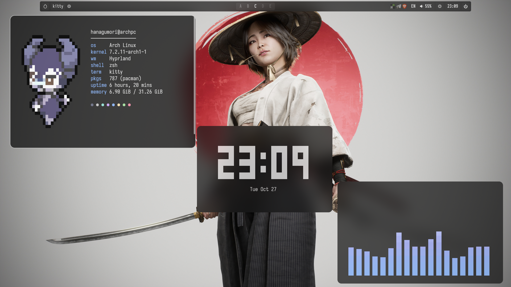

<div align="center">



<br><br>

[](https://www.youtube.com/watch?v=beIpVuMDd-8)
[](https://hypr.land)
[](https://archlinux.org)
[](https://github.com/332mindset/mainArchLinuxDotfiles/stargazers)

<br>



<sub>monochrome glass · smooth animations · catppuccin pastels in the terminal</sub>

</div>

<br>

## ✦ inside

<table>
<tr>
<td width="50%" valign="top">

**hyprland** — lua config, animations, rules<br>
**waybar** — frosted glass, workspaces A–F<br>
**rofi** — pill launcher, clipboard, wallpapers, power<br>
**hyprlock** — glass lock with now playing

</td>
<td width="50%" valign="top">

**kitty + zsh** — fastfetch with a random pokémon<br>
**swaync · cava** — notifications, visualizer<br>
**dolphin · gtk** — catppuccin mocha, papirus, bibata<br>
**scripts** — screenshots + satty, color picker

</td>
</tr>
</table>

## ✦ install

```sh
git clone https://github.com/332mindset/mainArchLinuxDotfiles.git
cd mainArchLinuxDotfiles
python3 install.py           # preview, changes nothing
python3 install.py --apply   # install (no sudo), old configs are backed up
```

Install the packages below first. Then log in to Hyprland and press **Super + F** to pick a wallpaper.

<details>
<summary><b>📦 packages</b></summary>
<br>

```sh
sudo pacman -Syu --needed \
  hyprland hyprlock waybar rofi kitty zsh swaync cava awww \
  git python wl-clipboard cliphist grim slurp libnotify \
  wireplumber pipewire pipewire-pulse playerctl pavucontrol \
  fastfetch dolphin fontconfig ttf-jetbrains-mono-nerd ttf-iosevka-nerd adwaita-fonts \
  breeze-icons papirus-icon-theme glib2 util-linux procps-ng coreutils \
  xdg-desktop-portal-hyprland ffmpeg imagemagick curl \
  pacman-contrib hyprpicker satty

yay -S --needed catppuccin-gtk-theme-mocha bibata-cursor-theme-bin papirus-folders-catppuccin-git krabby-bin
```

Optional: `brightnessctl` for brightness keys, `code` for the Rofi **Configs** tab.
On a bare TTY install, set up your user, network, `sudo` and GPU drivers first — the installer doesn't install packages or drivers.

</details>

<details>
<summary><b>🛠 after install: zsh, gtk, first launch</b></summary>
<br>

**Zsh** — oh-my-zsh, plugins and the example config (back up your `~/.zshrc` first):

```sh
git clone --depth 1 https://github.com/ohmyzsh/ohmyzsh.git ~/.oh-my-zsh
git clone --depth 1 https://github.com/zsh-users/zsh-autosuggestions ~/.oh-my-zsh/custom/plugins/zsh-autosuggestions
git clone --depth 1 https://github.com/zsh-users/zsh-syntax-highlighting ~/.oh-my-zsh/custom/plugins/zsh-syntax-highlighting
git clone --depth 1 https://github.com/catppuccin/zsh-syntax-highlighting ~/.oh-my-zsh/custom/catppuccin-highlighting
cp examples/zshrc ~/.zshrc
chsh -s /usr/bin/zsh
```

**GTK** — Catppuccin folders and the GTK 4 theme:

```sh
sudo papirus-folders -C cat-mocha-mauve --theme Papirus-Dark
theme=/usr/share/themes/catppuccin-mocha-mauve-standard+default/gtk-4.0
ln -sfn "$theme/gtk.css" "$theme/gtk-dark.css" "$theme/assets" ~/.config/gtk-4.0/
```

**Launch** — from a TTY: `start-hyprland -- --config "$HOME/.config/hypr/hyprland.lua"`

Keyboard is **US + RU** (**Super + Space**); set `kb_layout = "us"` in `hyprland.lua` for English only.

</details>

<details>
<summary><b>⌨ keybindings</b></summary>
<br>

| keys | action |
| --- | --- |
| Super + Q / E / D | Kitty / Dolphin / Rofi |
| Super + C | close window |
| Super + F | wallpaper picker |
| Ctrl + Super + V | clipboard history |
| Super + Shift + E | power menu |
| Super + L | lock |
| Super + N | notifications |
| Super + R | restart Waybar |
| Ctrl + End / + Shift | area / full screenshot |
| Ctrl + Alt + End | screenshot → Satty |
| Super + Shift + C | color picker (HEX) |
| Super + 1…9 / + Shift | switch / move to workspace |
| Super + Space | EN / RU |
| Super + V · P · J | float · pseudotile · split |
| Super + S / + Shift | scratchpad toggle / move |
| Super + wheel · drag | workspaces · move / resize |

</details>

<details>
<summary><b>🧩 compatibility & notes</b></summary>
<br>

- Built on Hyprland **0.56.2** with the **Lua config** (`hyprland.lua`) — older `hyprland.conf`-only versions won't work.
- Tested with Waybar 0.15.0, Rofi 2.0.0, Kitty 0.49.2, Hyprlock 0.9.6, SwayNC 0.12.6, Cava 1.0.0, awww 0.12.1.
- Monitors are auto-detected; the original two-monitor layout is in [`examples/monitors.lua`](examples/monitors.lua).
- Expects Zsh + oh-my-zsh, default `~/.config` and a home path without spaces.
- The palette is static — wallpapers don't recolor anything. Colors live in `waybar/matugen.css`, `kitty/matugen.conf`, `rofi/themes/matugen-colors.rasi`, `hypr/colors.lua`.
- Wallpapers go to `~/Pictures/Wallpapers`; the picker needs **awww**, not hyprpaper.

</details>

<details>
<summary><b>🩹 troubleshooting & restore</b></summary>
<br>

- Config errors: `hyprctl configerrors`. Reload a running desktop: `~/.config/hypr/scripts/apply-desktop.sh`.
- Boxes instead of icons → install JetBrainsMono and Iosevka Nerd Fonts.
- Backups go to `~/.local/state/dotfiles/backups/<date>/` and mirror your home (`BACKUP/.config/hypr` = old `~/.config/hypr`). To restore, remove the installed folder and copy the backup back.
- Config folders are replaced whole; `gtk-3.0`, `gtk-4.0` and `fontconfig` are updated file by file. Symlinked targets (Stow etc.) are refused. `~/.zshrc` is never touched.

</details>

<br>

<div align="center">

<sub>credits — waybar by <a href="https://github.com/JaKooLit">JaKooLit</a> · look from <a href="https://github.com/NischalDawadi/Hyprlust">Hyprlust</a> · rofi from <a href="https://github.com/adi1090x/rofi">adi1090x</a> · colors <a href="https://github.com/InioX/matugen">matugen</a> + <a href="https://github.com/catppuccin/catppuccin">catppuccin</a> · sprites <a href="https://github.com/yannjor/krabby">krabby</a></sub>

<br><br>

<sub>⭐ if you like the rice, a star helps a lot</sub>

</div>
