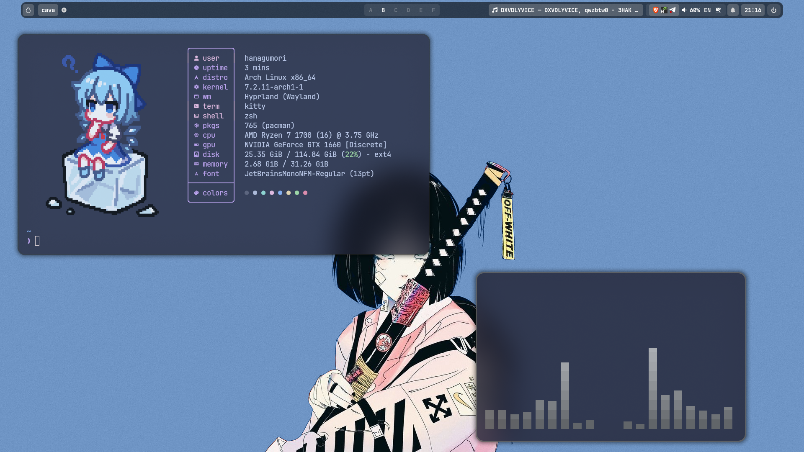

<h1 align="center">Arch Linux + Hyprland dotfiles</h1>

<p align="center">
  
</p>

<p align="center">
  
  
  
  <a href="https://www.youtube.com/watch?v=beIpVuMDd-8"></a>
</p>

My desktop configuration with colors taken from the wallpaper
([matugen](https://github.com/InioX/matugen), monochrome scheme): translucent
windows, smooth animations, a minimal frosted-glass Waybar, Rofi menus, a glass
lock screen and a matching terminal. GTK apps and Dolphin use
[Catppuccin Mocha](https://catppuccin.com).

[Watch the desktop showcase on YouTube](https://www.youtube.com/watch?v=beIpVuMDd-8).

**Install the dependencies below before applying these dotfiles.**
`install.py` copies configuration files, scripts and wallpapers and backs up
the files it replaces. Package installation, graphics driver setup and shell
integration are manual steps described below. Running `python3 install.py`
only previews the changes; add `--apply` to install the files.

## What's included

| Component | Configuration |
| --- | --- |
| Hyprland | Lua config, animations, window rules and keybindings |
| Waybar | Workspaces A–F, tray, volume and microphone, keyboard layout (EN/RU), idle inhibitor, pending updates (pacman + AUR) and notifications |
| Rofi | Launcher (apps, configuration folders, file browser), clipboard, wallpaper carousel and power menu |
| Kitty + Zsh | Wallpaper-colored terminal, oh-my-zsh prompt and a Fastfetch welcome card with a random pixel-art image |
| Hyprlock | Glass lock screen: blurred desktop, clock, avatar and now playing with cover art and player controls |
| SwayNC | Notification popups and control center |
| Cava | Standalone audio visualizer |
| Dolphin | Catppuccin stylesheet, KDE color scheme and launcher |
| GTK + Fontconfig | Catppuccin GTK theme, Papirus icons with mauve folders, Bibata cursors and fonts |
| Matugen | Recolors Waybar, Kitty, Rofi, SwayNC, Hyprland borders, Hyprlock and Firefox after every wallpaper change |
| Scripts | Clipboard history, screenshots with a Satty editor, color picker, wallpaper switching and power menu |

The wallpaper picker reads `~/Pictures/Wallpapers`. Wallpapers from the
[`wallpapers`](wallpapers) folder are installed there; add your own images
for more choices. On first open the picker caches rounded preview cards in
`~/.cache/wallpaper-picker`. After each change it runs `matugen` with
[`config/matugen/config.toml`](config/matugen/config.toml); the files it writes
(`waybar/matugen.css`, `kitty/matugen.conf`, `hypr/colors.lua`, …) ship with a
starting palette. The Firefox template targets my profile folder: change its
`output_path` to your own profile's `chrome/` folder, or remove that template.

## Compatibility

Prepared from an Arch Linux installation with Hyprland **0.56.2**, Waybar 0.15.0,
Rofi 2.0.0, Kitty 0.49.2, Zsh 5.9, Hyprlock 0.9.6, SwayNC 0.12.6, Cava 1.0.0 and
awww 0.12.1. These are the source machine's versions, not a guarantee that
every future update will behave the same.

This config uses Hyprland's **Lua API** (`hyprland.lua`). Older installations
that only support `hyprland.conf` cannot use it directly.
See the [Hyprland configuration documentation](https://wiki.hypr.land/configuring/core/).

The shared version selects monitor modes automatically. NVIDIA overrides from
the original machine are commented out. The original two-monitor layout is in
[`examples/monitors.lua`](examples/monitors.lua).

This setup expects Zsh with oh-my-zsh, a standard home path without spaces or special
characters, and the default `~/.config` location.

## Dependencies

These instructions start from an already installed Arch Linux system.
Review and install the packages below before following the installation steps.
The installer does not install packages or configure your graphics drivers.

You can apply these dotfiles from either a graphical session or a TTY.
On a minimal Arch installation with only a TTY, first set up a regular user,
working internet, access to `sudo`, and the graphics drivers appropriate for
your GPU. Then install the dependencies below (including Git and Python),
apply the dotfiles as that user, and launch Hyprland using the command in the
installation section. The Python installer alone does not prepare a bare
Arch installation for a graphical desktop.

```sh
sudo pacman -Syu --needed \
  hyprland hyprlock waybar rofi kitty zsh swaync cava awww \
  git python wl-clipboard cliphist grim slurp libnotify \
  wireplumber pipewire pipewire-pulse playerctl pavucontrol \
  fastfetch dolphin fontconfig ttf-jetbrains-mono-nerd ttf-iosevka-nerd adwaita-fonts \
  breeze-icons papirus-icon-theme glib2 util-linux procps-ng coreutils \
  xdg-desktop-portal-hyprland ffmpeg imagemagick curl \
  pacman-contrib hyprpicker satty matugen
```

The Catppuccin GTK theme, folder colors and Bibata cursors come from the AUR
(shown with [yay](https://github.com/Jguer/yay); any AUR helper works):

```sh
yay -S --needed catppuccin-gtk-theme-mocha bibata-cursor-theme-bin papirus-folders-catppuccin-git
```

`ffmpeg` renders wallpaper previews; `imagemagick` draws the lock screen cover
placeholder and color picker swatches; `pacman-contrib` provides `checkupdates`
for the Waybar updates counter. Optional: `brightnessctl` enables the brightness keys; `code` (Visual Studio
Code) enables the Rofi **Configs** tab. The desktop itself does not need VS Code.

## Installation

1. Clone the repository and open its folder:

   ```sh
   git clone https://github.com/332mindset/mainArchLinuxDotfiles.git
   cd mainArchLinuxDotfiles
   ```

   Alternatively, use **Code → Download ZIP**, extract it, and open a terminal
   in the extracted folder.
2. Review the configuration and preview the changes:

   ```sh
   python3 install.py
   ```

3. Install as your desktop user, **without sudo**:

   ```sh
   python3 install.py --apply
   ```

The installer copies files into your home directory, fills in your home path
where the templates contain `@HOME@`, and sets executable permissions on
scripts. Existing component folders/files are moved to a dated backup under
`~/.local/state/dotfiles/backups/`. Each listed config folder is replaced as a
whole, so settings from your old folder remain in the backup. Shared folders
(`gtk-3.0`, `gtk-4.0`, `fontconfig`) are updated file by file, so other data
there, such as GTK bookmarks, stays in place.

Symlinked destinations are refused: if you already manage your configuration
with Stow or another dotfiles manager, adapt the files through that manager.
The installer leaves `~/.zshrc` and your login configuration alone.

4. Set up Zsh: install oh-my-zsh with its plugins and the Catppuccin
   highlighting theme, copy the example config and make Zsh your login shell.
   Back up your current `~/.zshrc` first if you have one.

   ```sh
   git clone --depth 1 https://github.com/ohmyzsh/ohmyzsh.git ~/.oh-my-zsh
   git clone --depth 1 https://github.com/zsh-users/zsh-autosuggestions \
     ~/.oh-my-zsh/custom/plugins/zsh-autosuggestions
   git clone --depth 1 https://github.com/zsh-users/zsh-syntax-highlighting \
     ~/.oh-my-zsh/custom/plugins/zsh-syntax-highlighting
   git clone --depth 1 https://github.com/catppuccin/zsh-syntax-highlighting \
     ~/.oh-my-zsh/custom/catppuccin-highlighting
   cp examples/zshrc ~/.zshrc
   chsh -s /usr/bin/zsh
   ```

   The welcome card picks a random PNG from `~/.config/fastfetch/logos`.
   Add your own images there; square ones with a transparent background look
   best. Re-running the installer replaces this folder, so your own images
   end up in the backup.
5. Review `~/.config/hypr/hyprland.lua`. Keyboard layouts are **US + Russian**;
   **Super + Space** switches them. Set `kb_layout = "us"` and `kb_options = ""`
   if you only want English.
6. Apply the Catppuccin folder color and the GTK 4 theme (libadwaita apps read
   it from `~/.config/gtk-4.0`):

   ```sh
   sudo papirus-folders -C cat-mocha-mauve --theme Papirus-Dark
   theme=/usr/share/themes/catppuccin-mocha-mauve-standard+default/gtk-4.0
   ln -sfn "$theme/gtk.css" "$theme/gtk-dark.css" "$theme/assets" ~/.config/gtk-4.0/
   ```

7. Log out and start Hyprland again when ready. From a TTY, you can use:

   ```sh
   start-hyprland -- --config "$HOME/.config/hypr/hyprland.lua"
   ```

8. Press **Super + F** and choose a wallpaper. It will be restored on subsequent
   sessions after the first successful selection.

## Keybindings

`Super` is the Windows key.

| Keys | Action |
| --- | --- |
| Super + Q | Open Kitty |
| Super + C | Close the focused window |
| Super + E | Open Dolphin |
| Super + D | Open Rofi |
| Super + F | Choose a wallpaper |
| Super + N | Toggle notifications |
| Super + R | Restart Waybar |
| Super + L / Super + Shift + D | Lock the screen |
| Ctrl + Super + V | Clipboard history |
| Ctrl + End / Ctrl + Shift + End | Area / full screenshot, saved and copied |
| Ctrl + Alt + End | Area screenshot opened in Satty to annotate |
| Super + Shift + C | Pick a color on screen and copy its HEX |
| Super + Shift + E | Power menu |
| Super + 1…9 | Switch workspace |
| Super + Shift + 1…9 | Move window to workspace |
| Super + Space | Switch keyboard layout (EN/RU) |
| Super + arrows | Move focus |
| Super + V | Toggle floating |
| Super + P / Super + J | Pseudotile / toggle split |
| Super + S / Super + Shift + S | Toggle / move to scratchpad |
| Super + mouse wheel | Next / previous workspace on this monitor |
| Super + mouse drag | Move or resize a window |

The clipboard collector stores copied text/images locally; its history is
runtime data and is not included in this repository.

## Troubleshooting and backups

Check configuration errors with `hyprctl configerrors`. Reload an already
running desktop with `~/.config/hypr/scripts/apply-desktop.sh` after checking
your monitor settings. A fresh session also starts the clipboard collector
and notification daemon.

If symbols look like boxes, check that JetBrainsMono and Iosevka Nerd Fonts are installed.
The wallpaper picker requires **awww**, not hyprpaper.

To restore a previous configuration, use the backup directory printed by the
installer. It mirrors the replaced paths in your home (for example,
`BACKUP/.config/hypr` is the old `~/.config/hypr`). From another TTY/session,
remove or rename the corresponding installed component folder, then copy
its backed-up version into place. Files that did not exist before installation
have no backup. Your other configuration folders are not part of this install.

## Credits

Existing source comments and attributions are preserved:

- Waybar layout is based on [JaKooLit](https://github.com/JaKooLit)'s styling.
- Colors: generated from the wallpaper by [matugen](https://github.com/InioX/matugen);
  GTK and Dolphin use the [Catppuccin](https://github.com/catppuccin/catppuccin) Mocha palette.
- The bar, Rofi and notification look follows
  [Hyprlust](https://github.com/NischalDawadi/Hyprlust)'s "[Dark] Purpl".
- The Rofi theme is based on
  [adi1090x/rofi](https://github.com/adi1090x/rofi/blob/master/files/launchers/type-1/style-5.rasi)
  (type-1, style-5), recolored with Catppuccin Mocha.
